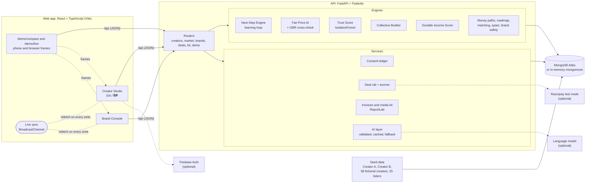

# JodiDar AI

> Other dashboards tell creators how they're doing. JodiDar AI tells them what to do next, prices it fairly, and makes sure they get paid.

A creator monetisation and brand opportunity engine, built by **Team TheVortex** for **CodeX 3.0** (Problem Statement 3). It runs locally with one command and works fully offline on seeded mock data.

- **Creator Studio** (mobile-first, dark): your stage, your next 3 moves, a fair price for every brand reel, a growth roadmap, ranked money paths, opportunities you opt in to, and deals that pay out through escrow. English or हिंदी.
- **Brand Console** (desktop, light): campaigns, creators ranked by audience fit with only the fields each creator chose to share, a collective builder for small creators, and the same deal rail from the brand's side.
- **Demo screens**: `/demo/compare` puts Creator A and Creator B side by side with a guided, captioned walkthrough; `/demo/live` runs a creator phone and a brand console next to each other, in sync.

## Run it

You need **Node 20+** and **Python 3.10+**. Nothing else: no keys, no database, and no internet after the first install.

```bash
make dev        # or: npm run dev   (works on Windows too)
```

The first run creates a Python virtual environment and installs dependencies (a few minutes). After that it starts in seconds.

| What | Where |
| --- | --- |
| App | http://localhost:5173 |
| Creator A vs Creator B, guided | http://localhost:5173/demo/compare?guide=1 |
| Live deal demo (phone + console) | http://localhost:5173/demo/live |
| API health | http://localhost:8000/api/health |

Other commands (run `make dev` first for the browser ones):

```bash
make demo       # build the web app and serve everything from one port: http://localhost:8000
make test       # API tests, copy rules on UI strings, type check
make e2e        # click through 14 key journeys in a real browser
make shots      # every screen at 390 px and 1440 px, plus an accessibility audit
make reset      # restore the seeded demo data (the app also has a "Reset demo" button)
```

## Environment variables

Every variable is optional. Copy `.env.example` to `.env` to turn a service on; with nothing set, each one falls back to a deterministic offline version and every screen still works.

| Variable | Used for | When it's not set |
| --- | --- | --- |
| `MONGODB_URI`, `MONGODB_DB` | MongoDB Atlas | In-memory database (mongomock), seeded on start |
| `ANTHROPIC_API_KEY`, `AI_MODEL` | Live AI for caption tagging, topic ideas and media-kit copy, via the official SDK with structured output validated by Pydantic. Both must be set | Deterministic templates from the same numbers |
| `RAZORPAY_KEY_ID`, `RAZORPAY_KEY_SECRET` | Razorpay **test mode** escrow orders and signature checks (`rzp_test_` keys only) | Simulated escrow and simulated UPI payouts |
| `VITE_FIREBASE_API_KEY`, `VITE_FIREBASE_AUTH_DOMAIN`, `VITE_FIREBASE_PROJECT_ID`, `VITE_FIREBASE_APP_ID` | Google sign-in before choosing a demo profile | Demo login with a profile picker |
| `DEMO_TODAY` | The date the demo treats as today, so seeded deadlines line up (default `2026-10-08`) | `2026-10-08` |

Every AI call goes through one function with a fallback: if the key is missing, the call fails, the reply breaks the copy rules, or it quotes a number that isn't in our data, the template is used instead. Answers are cached.

## Architecture



**Request flow.** A screen asks the API for one view (for example `/api/creators/cr_a/home`). The router loads the creator, runs the engines (stage, fair price, opportunities, money paths, durable income, next moves), and returns numbers together with a `why` block for each one: reasons, inputs with `real`/`simulated` provenance, and assumptions. The web app renders the numbers and puts the `why` one tap away.

**Live sync.** Every successful write in the web app is announced on a `BroadcastChannel`; every other open window or demo frame refetches what it shows. That is how the creator phone and the brand console on `/demo/live` stay in step without a server push.

### The engines, in short

| Engine | How it works |
| --- | --- |
| **Fair-Price AI** | Base = median views of the last 6 reels × the niche's CPM (₹100–200 per 1,000 views). Then capped adjustments: engagement ±15%, audience fit −20%/+12%, consistency ±8%, brand safety down to −15%, trust −20%/+5%, usage and exclusivity up to +40%. Shown as a waterfall next to the follower-based price. A GradientBoostingRegressor trained on 4,000 synthetic deals cross-checks the result. |
| **Trust Score** | IsolationForest over growth spikes, views and likes per follower, comments per like, generic-comment share and follow ratio. A small shield with the top two reasons; low-trust profiles are ranked last and kept out of collectives. |
| **Next-Step Engine** | Candidate moves from money, growth and opportunity generators; the best of each, with a reason, a ₹ or reach range, an effort size and a "Why?". Marking a move done (worked / partly / didn't land) picks next week's follow-up: lock the rate, offer a bundle, make it a series, or test a new hook. |
| **Collective Builder** | Greedy knapsack on effective reach × fit per rupee, with an audience-overlap penalty (city × language × niche) and a trust threshold of 60. Creators who opted in are included first. One escrow payment, split automatically by UPI. |
| **Durable-Income Score** | 100 × (0.5 diversification + 0.25 recurring share + 0.25 payment reliability), where diversification is 1 − HHI over income sources. Warns when one source is above 70%. |
| **Money paths** | Brand deals, services, digital products, affiliate, PR and collectives, each scored on fit, size against the creator's goal, and ease. Expertise-first creators (a skill, a small audience) see services first. |
| **Matching and consent** | Audience fit on niche, age, gender, language and region. Brands only see the fields a creator granted (stats, demographics, rate card); everything else is redacted and every view is logged in the consent ledger. |
| **Regional language** | Caption tagging by Unicode script and lexicons (Hindi, Hinglish, Tamil, Telugu, Kannada, Malayalam, Marathi, Bengali, Gujarati), topic ideas in the creator's language, and Hindi copy for the Studio. |

### Silent features

These stay out of the way until they matter:

- **Trust Score** badge with two reasons.
- **Low-offer alert** with a one-tap counter at the fair price.
- **Brand-safety notes**, with the fix already suggested to the creator.
- **Overlap de-dup** in collectives.
- **Spam and duplicate listings** hidden from creators.
- **Payment-delay nudges**, auto-release after the verification window, and auto-invoices.
- **Media kit PDF** and a `/c/:handle` link-in-bio page with "Book me".
- **"Why?" popovers** on every number.
- **EN/हिंदी toggle**.

### Motion and 3D

Motion is there to explain, not decorate. Every effect checks reduced motion first and falls back to a still, fully readable layout.

| Where | What it does |
| --- | --- |
| Landing (1280 px and wider) | A 3D "creator core" with brand cards and rupee coins in orbit, following the pointer and the scroll |
| Creator Studio home | **Reach vs followers in 3D**: the last 6 reels rise as bars through a glass plane set at the follower count, so "reach is about 7x followers" is visible at a glance. Hover a bar for its views |
| Brand Console overview | **Deal flow in 3D**: the six rail stages as rings on a glowing track, a coin for each deal at its stage, and tokens flowing from offer to UPI payout |
| Brand Console campaign | **Match space**: matched creators placed by fair price, reach and trust, coloured and sized by fit. Drag to turn it, hover for details, click to open a profile |
| Everywhere | Pages ease in; cards reveal and stagger as they scroll into view; move and KPI cards tilt toward the pointer; key numbers count up; a scroll-progress bar; the aurora background drifts with parallax |

The 3D scenes:

- Use three.js through React Three Fiber and drei.
- Load lazily: screens without 3D never download three.js.
- Pause when off screen.
- Fall back to 2D when WebGL isn't available.
- Use procedural lighting, so nothing is fetched from the network.
- Carry a text description for screen readers, and the same numbers are always in the HTML next to them.
- Leave the page scrolling normally: touch never rotates a scene.

### The deal rail

Offer → Contract (both sides e-sign) → Escrow funded → Post live (official link) → Verified (mock official-API insights check) → Paid by UPI.

- A creator posts only once the money is held.
- If the brand doesn't confirm within 3 days of the verification deadline, escrow releases to the creator automatically.
- Collectives fund once and split automatically.

## 3-minute demo script

Before you start, click **Reset demo** (top of `/demo/compare`). Present on a laptop or projector at 1440 px or wider.

| Time | Do this | Say this |
| --- | --- | --- |
| 0:00 | Open http://localhost:5173 and click **Watch the demo**. The guided demo starts on `/demo/compare`. | "Same engine, two very different creators. Every number has a reason, and every range is an estimate, not a promise." |
| 0:15 | Step 1 → 2 (press →). | "Creator A makes anime edits, 21.3K followers, and already earns. Creator B cooks Tamil home food with 2K followers. A is *Earning, underpriced*; B is *Starting*." |
| 0:40 | Step 3: Fair price. Open A's **Why?**. | "A's reels reach about 7x their followers. Priced on reach that's ₹17K–18K a reel; priced on followers it's ₹7K, which is what they quote. Every adjustment is capped and explained." |
| 1:05 | Steps 4–5: Roadmap and money paths. | "A keeps their best format and adds original voiceover, which removes a copyright risk. B fills a gap nobody else in Tamil food is covering: quick breakfasts. Money paths are ranked against each goal: anime-merch affiliate and gaming collectives for A; a food collective, a ₹199 e-book and kitchenware affiliate for B." |
| 1:30 | Steps 6–7. Then press **P** for two phones. | "Matches are opt-in: brands see only what each creator shares. And this is what each creator actually sees each week: their next 3 moves." On A's phone, tap **हिं** to show the Hindi Studio. |
| 1:55 | Click **Live deal demo**. On the phone tap **Counter at ₹17,362**, then **Send counter**. | "Senpai offered ₹7,300, 58% below fair. One tap counters with the reasons attached." |
| 2:15 | In the console: **Accept ₹17,362 and sign** (confirm in the dialog) → **Fund escrow** → **Pay ₹17,362 (simulated)**. On the phone: **Submit post link** (any `instagram.com/reel/...` link). In the console: **Confirm post and release payment**. | "Both sides sign. The brand funds escrow before the creator posts. Once the post is verified, the payout goes out by UPI and the invoice is marked paid. Each side updates live." |
| 2:35 | Open the Brand Console campaign (`/brand/campaigns/lst_senpai_hoodie?as=br_senpai`) and turn the **Match space**. | "Brands see every match by price, reach and trust. Up and to the left is more reach per rupee; hollow spheres are weak trust or unshared stats." |
| 2:45 | Back on **Live deal demo**, switch the scenario to **Collective**. On the phone, open the Thalam Foods collective, tap **Opt in**, then **Opt in and share**. The pack updates in the Thalam Foods console. | "Small creators get big-brand deals as a 20-creator collective, with overlap removed and low-trust profiles left out." |
| 2:55 | Close. | "No guarantees, no scraping, and the reference creator stays anonymous. That's JodiDar AI." |

Keyboard: **P** toggles phone view anywhere. In the guided demo, **←** and **→** move between steps and **Esc** ends it. Any link takes `?phone=1` to open in phone view and `?lang=hi` to open the Studio in Hindi.

## Demo profiles

Sign in at `/login` with no password: pick a profile.

| Profile | Who | What to look at |
| --- | --- | --- |
| **Creator A** | Anime-edit reels in Hindi and English, 21.3K followers. Reference profile based on a real creator interview: identity withheld, some fields simulated, and every simulated value is marked. | Fair price ₹17K–18K vs ₹7K on followers; low-offer alert; deal rail; media kit |
| **Creator B** | Tamil home cooking, 2K followers, ₹10K/month goal (fictional) | Tamil quick-breakfast gap; Thalam Foods collective; ₹199 e-book |
| **New creator** | Onboarding from scratch | Niche, platforms, format, audience stage, income goal, languages, city; mocked official login; caption reading |
| **Senpai Supply Co.** | Anime merch store (fictional) | Matches with trust and safety notes; offers; deals |
| **Thalam Foods** | Regional masala brand (fictional) | 20-creator South collective |
| **New brand** | Brand onboarding | Campaign set-up |

## Data rules

- **No scraping**, and no unauthorised platform access. Data comes only from official login (mocked here), what a creator types or uploads, and seeded mock data. `backend/tests/test_no_scraping.py` enforces this, and the QA scripts only ever visit localhost.
- **No promises.** Every forecast is a range with assumptions and a confidence level, labelled "Estimate, not a promise". `shared/copy-rules.json` bans words like "guaranteed", "viral", "overnight" and "100%", in English and Hindi. The build fails if they appear in:
  - UI copy (`frontend/scripts/check-copy.mjs`, which runs before every build);
  - backend source strings;
  - API responses for a sample of creators and brands (`backend/tests/test_copy_rules.py`);
  - rendered screens (`qa/screenshots.mjs`).
- **The reference creator stays anonymous.** Creator A has no name, photo, handle or city. Real values (followers, following, posts, the last 6 reels' views and dates, average likes and comments, best deal) carry a `real` provenance flag; the rest are `simulated` and marked in the UI. Every other profile, brand and listing is fictional, and no real brand logos are used.

## Accessibility

- Checked with axe-core (WCAG 2 A/AA plus best practices) on every screen at 390 px and 1440 px.
- Skip links in the Studio, the Console and the demo screens; visible focus rings; and keyboard support for all dialogs, popovers, segmented controls and the guided demo.
- Charts have text equivalents.
- Respects reduced motion: Framer Motion and CSS transitions are switched off.
- Hindi text uses Noto Sans Devanagari with letter-spacing turned off, so the headline bar stays intact.

## Tests and QA

| Command | What it checks |
| --- | --- |
| `make test` | 47 API tests (below), the copy rules on about 2,900 UI strings, and the TypeScript type check |
| `make e2e` | 14 journeys in a real browser (below) |
| `make shots` | 62 screenshots (31 screens × 390 px and 1440 px). Each screen is also checked with axe-core, against the copy rules, for console errors and for horizontal scrolling. Output in `qa/shots` and `qa/report/qa.json` |

The API tests cover:

- Creator A's and Creator B's expected outputs.
- Every engine.
- Consent redaction.
- The deal rail, escrow and auto-release.
- AI fallbacks.
- Hindi copy.
- Copy rules on source strings and live responses.
- The no-scraping check.

The e2e journeys:

- Onboarding.
- The weekly learning loop.
- Pricing per brand.
- "Why?" popovers.
- Collective opt-in.
- A brand sending an offer.
- Revoking consent.
- The full deal rail.
- Link-in-bio booking.
- Hindi.
- The guided compare.
- Phone view.
- Live sync.
- The 3D scenes drawing with WebGL.

## Project layout

```
backend/
  app/engines/     fair price, trust, next step, collective, durable income, matching, money paths, roadmap, spam, brand safety, Hindi copy
  app/services/    consent ledger, deal rail, payments, PDFs, view builders
  app/ai/          AI layer (validated output, copy rules, number grounding, cache, fallback) and regional caption tagging
  app/routers/     HTTP API
  app/seed/        Creator A (reference), Creator B, fictional roster, brands, listings, deals
  tests/           pytest suite
frontend/
  src/features/    creator (Studio), brand (Console), deals (shared deal view), demo (compare, live), public (landing, login, link-in-bio)
  src/components/  ui primitives, shared pieces (Why?, Trust, estimates, kit), charts, demo frames, motion, three (3D scenes)
  src/i18n/        English and Hindi
shared/            copy rules used by both test suites
qa/                Playwright screenshots, accessibility audit and e2e journeys (localhost only)
scripts/           cross-platform dev, demo and test runners
```

## Stack

- **Web**: React 19, TypeScript, Vite, Tailwind CSS 4, Radix primitives (shadcn-style), Framer Motion, three.js with React Three Fiber and drei, Recharts, Lucide, React Router, TanStack Query; Sora and Inter.
- **API**: FastAPI, Pydantic, scikit-learn, ReportLab, httpx.
- **Data and services**: MongoDB or mongomock; optional Firebase Auth, Razorpay test mode and a language model.
