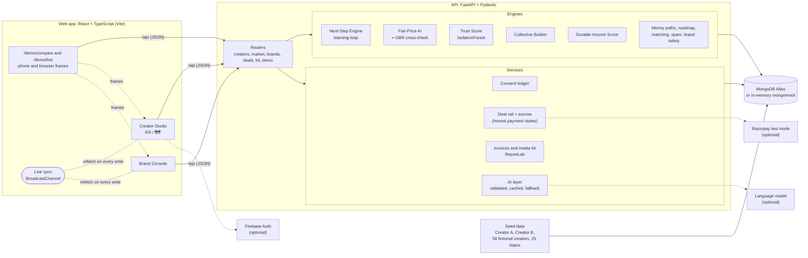

# DealMeet AI

> Other dashboards tell creators how they're doing. DealMeet AI tells them what to do next, prices it fairly, and makes sure they get paid.

A creator monetisation and brand opportunity engine, built by **Team TheVortex** for **CodeX 3.0** (Problem Statement 3). It runs locally with one command and works fully offline on seeded mock data.

- **Creator Studio** (mobile-first, dark): your stage, your next 3 moves, a fair price for every brand reel, a growth roadmap, ranked money paths, opportunities you opt in to, and deals funded through escrow before you post. English or हिंदी.
- **Brand Console** (desktop, light): campaigns, creators ranked by audience fit with only the fields each creator chose to share, a collective builder for small creators, and the same deal rail from the brand's side.
- **Demo screens**: `/demo/compare` puts Creator A and Creator B side by side with a guided, captioned walkthrough; `/demo/live` runs a creator phone and a brand console next to each other, in sync.

## Run it

You need **Node 22.12+** (20.19+ also works) and **Python 3.10 to 3.14** (3.13 recommended). Nothing else: no keys, no database, and no internet after the first install.

On Windows, clone or unzip the project into a short folder such as `C:\DealMeet-AI`: the Python packages have long file paths, and Windows limits a path to 260 characters unless long paths are turned on.

```bash
make dev        # or: npm run dev   (works on Windows too)
```

The first run creates a Python virtual environment and installs dependencies (a few minutes). After that it starts in seconds.

| What | Where |
| --- | --- |
| App | http://localhost:5173 |
| Creator A vs Creator B, guided | http://localhost:5173/demo/compare?guide=1 |
| Live deal demo (phone + console) | http://localhost:5173/demo/live |
| API health | http://localhost:8000/api/health |

Other commands. Each `make` command has an `npm run` twin for Windows. Run `make setup` or `make dev` once first to install dependencies; `e2e`, `shots` and `reset` also need the app running.

```bash
make setup      # or: npm run setup   install dependencies only
make demo       # or: npm run demo    build the web app and serve everything from one port: http://localhost:8000
make test       # or: npm test        API tests, copy rules on UI strings, type check
make e2e        # or: npm run e2e     click through 30 key journeys in a real browser
make accounts   # or: npm run accounts  real accounts with demo mode OFF, at 390 px and 1280 px (starts its own API)
make shots      # or: npm run shots   every screen at 390 px and 1440 px, plus an accessibility audit
                # (e2e and shots need a browser once: npx playwright install chromium)
make reset      # or: npm run reset   restore the seeded demo data (the app also has a "Reset demo" button)
```

### Updating your local copy

1. Stop the running app (**Ctrl+C** in its terminal), so ports 8000 and 5173 are free.
2. Get the latest code: `git stash` first if you have local edits, then `git pull` on your branch (or `git fetch origin && git checkout <branch>` to try a branch that isn't merged yet).
3. Run `make dev` (Windows: `npm run dev`). It reinstalls the API and web dependencies on its own when `requirements.txt` or `package-lock.json` changed, so the first start after an update can take a few minutes.
4. Open http://localhost:5173 and press **Ctrl+Shift+R** if the page still looks old. Click **Reset demo** for fresh sample data; the demo keeps its data in memory, so a restart also resets it.
5. New settings, if any, are in `.env.example`. All are optional for the demo.

If the dependency install fails, check `python --version` (3.10 to 3.14), delete `backend/.venv` and run `make dev` again. "Port already in use" means the old app is still running.

## Setup: from the demo to real services

The demo needs nothing. To run with real accounts and live data, set these up in order. Each step works on its own: anything you skip says "not connected" in the app instead of showing made-up numbers. Put values in `.env` locally (copy `.env.example`) or in your host's environment (secrets on Render), never in the repository.

1. **Real accounts, no demo**: set `DEMO_MODE=0`. No seeded data, no persona sign-in, no reset; people sign up with email and password. Check it with `make accounts` (below).
2. **Database (MongoDB Atlas)**: follow [Atlas setup](#database), then set `MONGODB_URI`, `MONGODB_DB=jodidar` and `USE_MOCK_DB=0`. For the brand directory's full-text search, create the Atlas Search index from `backend/atlas/brands_search.json` (name `brands_search`, or set `ATLAS_SEARCH_INDEX`); without it the directory uses a plain text match.
3. **Sample data (optional)**: `make seed` loads the synthetic sample data into empty collections, every record marked `source: "synthetic"` and shown as "Sample data". `make seed ARGS="--reset --confirm-reset"` replaces only synthetic records.
4. **YouTube API key**: follow [Google Cloud setup](#real-youtube-data-and-what-am-i-worth) and set `YOUTUBE_API_KEY`. Turns on `/worth` and linking a channel by @handle.
5. **Firebase (Google and phone sign-in)**: follow [Firebase setup](#firebase-setup-one-time) and set the four `VITE_FIREBASE_*` values (build-time) and `FIREBASE_SERVICE_ACCOUNT_JSON` (server).
6. **Google OAuth test users (YouTube Analytics and "Continue with YouTube")**: in the Firebase project's Google Cloud console, enable the YouTube Analytics API, add the `youtube.readonly` and `yt-analytics.readonly` scopes to the OAuth consent screen, keep the app in **Testing** and add each creator's Google account as a **test user** ([details](#youtube-analytics-optional)). With Firebase and `YOUTUBE_API_KEY` both set, creators also get **Continue with YouTube** on the sign-in page.
7. **Meta app with Instagram Testers**: follow the [Meta dashboard steps](#connecting-instagram); set `IG_APP_ID`, `IG_APP_SECRET`, `IG_REDIRECT_URI` (HTTPS), `FRONTEND_URL` and `TOKEN_ENC_KEY`. Each creator who connects must be an Instagram Tester with a Creator or Business account while the app is in development mode. The same settings turn on **Continue with Instagram** on the sign-in page.
8. **Payments (optional)**: Razorpay test keys `RAZORPAY_KEY_ID`, `RAZORPAY_KEY_SECRET` and the webhook secret `RAZORPAY_WEBHOOK_SECRET` (webhook URL: `/api/payments/razorpay/webhook`).
9. **Live AI (optional)**: `ANTHROPIC_API_KEY` and `AI_MODEL`, with `AI_MAX_CALLS_PER_HOUR` as a cap.
10. **An admin**: sign up, then on the server `python -m app.admin_cli grant <email>` (in `backend/`).

**Switching between sample and real data**: `make dev` with no `MONGODB_URI` runs the in-memory demo (`USE_MOCK_DB=1`, `DEMO_MODE=1`). With `MONGODB_URI` set, `make dev` uses that database instead; add `DEMO_MODE=0` for real accounts only. The API never falls back to the in-memory database on its own: if `MONGODB_URI` is set and unreachable, it stops with a clear message. Every number in the app carries its source: "Live data" (from YouTube or Instagram), "Self-reported" (typed by the creator) or "Sample data" (seeded).

Every variable is listed in [Environment variables](#environment-variables) and in `.env.example` with a comment.

## Environment variables

Every variable is optional. Copy `.env.example` to `.env` to turn a service on; with nothing set, each one falls back to a deterministic offline version and every screen still works.

| Variable | Used for | When it's not set |
| --- | --- | --- |
| `MONGODB_URI`, `MONGODB_DB` | MongoDB Atlas (or any MongoDB), with TLS certificates from certifi | Without `USE_MOCK_DB=1`, startup stops with a clear message. The API never falls back to memory on its own |
| `USE_MOCK_DB` | `1`: in-memory database (mongomock); data is lost on restart. `make dev` sets it when `MONGODB_URI` is empty; the Docker image sets it for the shared demo | `0` |
| `ATLAS_SEARCH_INDEX` | Atlas Search index for the brand directory (`backend/atlas/brands_search.json`) | `brands_search`; empty or `off` uses a plain text match |
| `ANTHROPIC_API_KEY`, `AI_MODEL` | Live AI for caption tagging, topic ideas and media-kit copy, via the official SDK with structured output validated by Pydantic. Both must be set | Deterministic templates from the same numbers |
| `RAZORPAY_KEY_ID`, `RAZORPAY_KEY_SECRET` | Razorpay **test mode** for the brand's payment into escrow (`rzp_test_` keys only). Each order is stored with its deal and amount; checkout must match both, and a payment is used once. A failed Razorpay call is an error (502), never a simulated success | Demo mode: a simulated payment, labelled so. Otherwise funding answers 503 and no money moves |
| `RAZORPAY_WEBHOOK_SECRET` | Verifies Razorpay webhooks at `/api/payments/razorpay/webhook` (`payment.captured`, `order.paid`, `payment.failed`). Each event is applied once | The webhook answers 503 |
| `VITE_FIREBASE_API_KEY`, `VITE_FIREBASE_AUTH_DOMAIN`, `VITE_FIREBASE_PROJECT_ID`, `VITE_FIREBASE_APP_ID` | Google and phone (OTP) sign-in in the browser, through Firebase | Email and password only; the page says Google and phone sign-in aren't configured |
| `FIREBASE_SERVICE_ACCOUNT_JSON` or `GOOGLE_APPLICATION_CREDENTIALS`, `FIREBASE_PROJECT_ID` | Server-side check of every Firebase ID token (Admin SDK): signature, expiry, this project, not revoked | `POST /api/auth/firebase` answers 503 |
| `YOUTUBE_API_KEY` | Real YouTube channel numbers: the public "What am I worth?" page (`/worth`), linking a channel by @handle and, with Firebase, **Continue with YouTube** | Both say YouTube data isn't connected; no YouTube button on the sign-in page |
| `IG_APP_ID`, `IG_APP_SECRET`, `IG_REDIRECT_URI`, `FRONTEND_URL`, `TOKEN_ENC_KEY` | Connecting Instagram with its official login (read-only), **Continue with Instagram** for creators, real post checks on deals | Instagram shows "not available" and the sign-in page has no Instagram button; post checks read "not checked" |
| `IG_GRAPH_VERSION`, `IG_DEMOGRAPHICS_TIMEFRAME` | Meta Graph API version and the audience-demographics window | `v25.0`, `this_month` |
| `DEMO_MODE` | `1`: the sandbox. Seeded personas, persona sign-in, **Reset demo** and timed resets. `make dev`, `make demo` and the Docker image set it unless you set `DEMO_MODE=0` | `0`: real accounts only. No seeded data, no persona sign-in, no reset |
| `DEMO_ADMIN` | `1`: a "Demo admin" persona for walking through `/admin` locally. Ignored outside demo mode and on a demo that resets itself. `make dev` sets it | No demo admin; admins only via `python -m app.admin_cli grant <email>` |
| `SESSION_HOURS` | How long a sign-in lasts | 72 |
| `DEMO_TODAY` | The date the demo treats as today, so seeded deadlines line up (default `2026-10-08`) | `2026-10-08` |
| `DEMO_RESET_MINUTES` | On a shared URL, put the demo data back to its seeded state every N minutes (skipped while someone changed something in the last 5 minutes). The Docker image sets 30 | Never resets on its own |
| `AI_MAX_CALLS_PER_HOUR` | Cap on live AI calls across all visitors; beyond it, templates are used | 100 |
| `TEE_ENDPOINT`, `TEE_TRUST_ROOT`, `TEE_MEASUREMENTS`, `TEE_ATTESTATION_MAX_AGE_S` | Protected computation in an AWS Nitro enclave, accepted only when its attestation verifies against the trust root and PCR policy ([details](#protected-computation-tee-status-and-fallback)) | TEE status `not_configured`; the audience overlap runs on the server from minimised data, and says so |

Every AI call goes through one function with a fallback: if the key is missing, the call fails, the reply breaks the copy rules, or it quotes a number that isn't in our data, the template is used instead. Answers are cached.

## Database

`backend/app/db.py` is the only place that connects to MongoDB. It creates its indexes on every start (safe to repeat): unique `users.email`, `users.firebase_uid`, `users.instagram_uid`, `users.youtube_channel_id`, `creators.handle`, `brands.slug`, `connections (user_id, platform)` and `posts (creator_id, platform, post_id)`, plus `metric_snapshots (creator_id, platform, date)` and indexes on owner ids, deal stage and campaign status. One-time sign-in codes live in `login_codes` (stored hashed, 2 minutes). `/api/health` pings it and reports `mock`, `atlas` or `mongodb` (503 when the ping fails).

Load the sample data, every record marked `source: "synthetic"`:

```bash
make seed                                     # or: npm run seed   (only into empty collections)
make seed ARGS="--reset --confirm-reset"      # or: npm run seed -- --reset --confirm-reset
```

On a real database `--reset` needs `--confirm-reset` and replaces only records marked synthetic and the seeded demo accounts; real accounts and their data stay. The **Reset demo** button and `DEMO_RESET_MINUTES` exist only in demo mode.

**Atlas setup** (one time):

1. Create a free cluster at cloud.mongodb.com.
2. Database Access: add a database user with a strong password (read and write to any database is enough).
3. Network Access: allow Render's outbound IP addresses (Render dashboard → your service → Connect → Outbound), or 0.0.0.0/0 for the hackathon only, with that strong password.
4. Connect → Drivers: copy the `mongodb+srv://...` string and put the password in it.
5. On Render (Environment) set `MONGODB_URI` to that string, `MONGODB_DB=jodidar` and `USE_MOCK_DB=0`. Locally, put the same in `.env`.
6. Optional: run `make seed` once against it to load the sample data.

`TEST_MONGODB_URI=... make test` also runs an integration test that writes, reconnects with a new client and reads back.

## Deploy

The repo builds into one container: the API serves the built web app on the port the host gives it (`$PORT`, default 8000).

```bash
docker build -t jodidar-ai .
docker run -p 8000:8000 jodidar-ai      # http://localhost:8000
```

- **Render**: New → Blueprint → pick this repository → Apply. `render.yaml` sets up a free Docker web service with the health check at `/api/health`. Free services sleep after 15 minutes without visitors; the first visit after that takes about a minute.
- **Any other Docker host** (Railway, Fly.io, Google Cloud Run, Hugging Face Spaces): point it at the `Dockerfile`. Health check path: `/api/health`.
- **Run one instance with one worker** while `USE_MOCK_DB=1`: the demo data lives in the server's memory, so a second instance would see different data. With Atlas (`MONGODB_URI`, `USE_MOCK_DB=0`) data survives restarts.
- **Everyone shares one demo.** The image runs with `DEMO_MODE=1`. Data resets on every restart, and every 30 minutes when idle (`DEMO_RESET_MINUTES`). The Studio and Console say so next to **Reset demo**, which resets it for everyone. Set `DEMO_MODE=0` on the host for real accounts only: then there is no seeded data, no persona sign-in and no reset.
- **Leave `ANTHROPIC_API_KEY` unset on a public URL**, or set a spend limit on the key: every visitor could otherwise trigger paid calls (capped by `AI_MAX_CALLS_PER_HOUR`).
- Razorpay accepts `rzp_test_` keys only. `VITE_FIREBASE_*` values are baked in at build time (Docker build args), and the deployed domain must be added to Firebase's authorised domains.
- Visitor-created records are capped (100 sign-ups, 50 new brands, 20 campaigns or collabs each, 30 bookings per creator, 50 offers per brand), and requests over 256 KB are refused.

## Architecture



**Request flow.** A screen asks the API for one view (for example `/api/creators/cr_a/home`). The router loads the creator, runs the engines (stage, fair price, opportunities, money paths, durable income, next moves), and returns numbers together with a `why` block for each one: reasons, inputs with `real`/`simulated` provenance, and assumptions. The web app renders the numbers and puts the `why` one tap away.

**Live sync.** Every successful write in the web app is announced on a `BroadcastChannel`; every other open window or demo frame refetches what it shows. That is how the creator phone and the brand console on `/demo/live` stay in step without a server push.

### The engines, in short

| Engine | How it works |
| --- | --- |
| **Fair-Price AI** | Base = median views of the last 6 reels × the niche's CPM (₹100–200 per 1,000 views). Then capped adjustments: engagement ±15%, audience fit −20%/+12%, consistency ±8%, brand safety down to −15%, trust −20%/+5%, usage and exclusivity up to +40%. Shown as a waterfall next to the follower-based price. A GradientBoostingRegressor trained on 4,000 synthetic deals cross-checks the result. |
| **Trust Score** | IsolationForest over growth spikes, views and likes per follower, comments per like, generic-comment share and follow ratio. A small shield with the top two reasons; low-trust profiles are ranked last and kept out of collectives. |
| **Next-Step Engine** | Candidate moves from money, growth and opportunity generators; the best of each, with a reason, a ₹ or reach range, an effort size and a "Why?". Marking a move done (worked / partly / didn't land) picks next week's follow-up: lock the rate, offer a bundle, make it a series, or test a new hook. |
| **Collective Builder** | Greedy knapsack on effective reach × fit per rupee, with an audience-overlap penalty (city × language × niche) and a trust threshold of 60. Creators who opted in are included first. One escrow payment for the pack, split by member. |
| **Durable-Income Score** | 100 × (0.5 diversification + 0.25 recurring share + 0.25 payment reliability), where diversification is 1 − HHI over income sources. Warns when one source is above 70%. |
| **Money paths** | Brand deals, services, digital products, affiliate, PR and collectives, each scored on fit, size against the creator's goal, and ease. Expertise-first creators (a skill, a small audience) see services first. |
| **Matching and consent** | Audience fit on niche, age, gender, language and region. Brands only see the fields a creator granted (stats, demographics, rate card); everything else is redacted and every profile a brand opens is logged in the consent ledger. |
| **Regional language** | Caption tagging by Unicode script and lexicons (Hindi, Hinglish, Tamil, Telugu, Kannada, Malayalam, Marathi, Bengali, Gujarati), topic ideas in the creator's language, and Hindi copy for the Studio. |

### Silent features

These stay out of the way until they matter:

- **Trust Score** badge with two reasons.
- **Low-offer alert** with a one-tap counter at the fair price.
- **Brand-safety notes**, with the fix already suggested to the creator.
- **Overlap de-dup** in collectives.
- **Spam and duplicate listings** hidden from creators.
- **Payment-delay nudges**, automatic approval after the review window, and auto-invoices.
- **Media kit PDF** and a `/c/:handle` link-in-bio page where brands can book the creator.
- **"Why?" popovers** on every number.
- **EN/हिंदी toggle**.

### Motion and 3D

Motion is there to explain, not decorate. Every effect checks reduced motion first and falls back to a still, fully readable layout.

| Where | What it does |
| --- | --- |
| Landing | A light hero card over a looping background video (paused on its first frame with reduced motion). Over it, a **deal mosaic** (`features/public/DealMosaic.tsx`): three columns of grainy tiles drifting forever in alternating directions, each tile one DealMeet idea (connect Instagram or YouTube, next 3 moves, fair price, audience fit, collectives, escrow, paid on approval, media kit, English or हिंदी), with no numbers or names, and black-and-white photo tiles between them once photos are added to `frontend/src/assets/mosaic/photos.ts` (six slots; an empty slot is left out, so it works with none). Pure CSS loops; the columns ease in once, pause while the hero is off-screen and stand still with reduced motion. Then a floating pill navigation with **Check your worth** emphasised, and a "Works with" logo scroller in pure CSS that pauses on hover and becomes a still, wrapped list with reduced motion. The landing loads no 3D |
| Creator Studio home | **Reach vs followers in 3D**: the last 6 reels rise as bars through a glass plane set at the follower count, so "reach is about 7x followers" is visible at a glance. Hover a bar for its views |
| Brand Console overview | **Deal flow in 3D**: the six rail stages as rings on a glowing track, a coin for each deal at its stage, and tokens flowing from offer to payout |
| Brand Console campaign | **Match space**: matched creators placed by fair price, reach and trust, coloured and sized by fit. Drag to turn it, hover for details, click to open a profile |
| Everywhere | Pages ease in; cards reveal and stagger as they scroll into view; move and KPI cards tilt toward the pointer; key numbers count up; a scroll-progress bar; the aurora background drifts with parallax |

The 3D scenes:

- Use three.js through React Three Fiber and drei.
- Load lazily: screens without 3D never download three.js.
- Pause when off screen.
- Fall back to 2D when WebGL isn't available.
- Use procedural lighting, so nothing is fetched from the network.
- Carry a text description for screen readers, and the same numbers are always in the HTML next to them.
- Leave the page scrolling normally: touch never rotates a scene.

### The deal rail

Offer → Contract (both sides accept the same version) → Escrow funded → Post submitted → Approved → Paid out.

- A creator posts only once escrow is funded: a verified Razorpay test payment, or in demo mode a simulated one (labelled "simulated, no money moved").
- The brand reviews the post link and approves it or asks for a revision with a reason. If the brand doesn't respond within 3 days of the review deadline, the post is approved automatically.
- Automatic post checks need the creator's connected account. Until then each check reads "not checked" and the brand's review decides.
- **There is no payout integration.** A deal funded through Razorpay stops at "Approved, payout not connected". In demo mode a simulated payment gets a simulated payout, labelled so, with no bank reference. Nothing is called paid unless it was.
- Collectives fund once for the whole pack, only after every member has confirmed their own terms; each member's share is released after their post is approved.
- `/api/health` reports the real modes of payments, payouts, social data and post checks.

**Contract versions** (`services/contracts.py`). An offer carries full terms: deliverables, a posting deadline, the fee, usage rights and exclusivity. Each set of terms is an immutable version with a SHA-256 hash of its terms, its author and time; the brand's offer is version 1, accepted by the brand. Either side can **propose changes** to any term on their turn (the creator's "Counter" changes just the fee); every proposal is a new version, never an edit. Each acceptance records who, when and which version, and the contract is agreed only when both sides accept the same, latest version. The agreed version's hash is on the contract.

**Status machine**: offer → negotiating → contract agreed → in progress → submitted ⇄ revision requested → approved → payment pending → paid, and cancelled. Every action is checked against the allowed transitions on the server and each change is written to the audit log. Escrow funding and payment statuses change only from verified payment events (or, in demo mode, a labelled simulated payment); a real payment with no payout partner stays at "payment pending".

**Deliverables**: the creator submits up to 5 links and a note; automatic post checks run when an account is connected; the brand approves or asks for a revision with a reason, and each revision round is tracked. Repeated submissions, double-clicked approvals and retried requests are no-ops: each action carries a key for the deal's current state, and actions that are already done return the deal unchanged.

## 3-minute demo script

Before you start, click **Reset demo** (top of `/demo/compare`). On a shared URL, reset only when you start your own walkthrough: it resets the data for everyone. Present on a laptop or projector at 1440 px or wider.

| Time | Do this | Say this |
| --- | --- | --- |
| 0:00 | Open the app (http://localhost:5173 locally, or your deployed URL) and click **Watch the demo**. The guided demo starts on `/demo/compare`. | "Same engine, two very different creators. Every number has a reason, and every range is an estimate, not a promise." |
| 0:15 | Step 1 → 2 (press →). | "Creator A makes anime edits, 21.3K followers, and already earns. Creator B cooks Tamil home food with 2K followers. A is *Earning, underpriced*; B is *Starting*." |
| 0:40 | Step 3: Fair price. Open A's **Why?**. | "A's reels reach about 7x their followers. Priced on reach that's ₹17K–18K a reel; priced on followers it's ₹7K, which is what they quote. Every adjustment is capped and explained." |
| 1:05 | Steps 4–5: Roadmap and money paths. | "A keeps their best format and adds original voiceover, which removes a copyright risk. B fills a gap nobody else in Tamil food is covering: quick breakfasts. Money paths are ranked against each goal: anime-merch affiliate and gaming collectives for A; a food collective, a ₹199 e-book and kitchenware affiliate for B." |
| 1:30 | Steps 6–7. Then press **P** for two phones. | "Matches are opt-in: brands see only what each creator shares. And this is what each creator actually sees each week: their next 3 moves." On A's phone, tap **हिं** to show the Hindi Studio. |
| 1:55 | Click **Live deal demo**. On the phone tap **Counter at ₹17,362**, then **Send counter**. | "Senpai offered ₹7,300, 58% below fair. One tap counters at the fair price." |
| 2:15 | In the console: **Accept ₹17,362 and sign** (confirm in the dialog) → **Fund escrow** → **Pay ₹17,362 (simulated)**. On the phone: **Submit post link** (any `instagram.com/reel/...` link). In the console: **Approve post**. | "Both sides sign. The brand funds escrow before the creator posts, then reviews the post and approves it. In the demo the payment and payout are simulated and say so; with Razorpay connected the deal stops at 'payout not connected' until a payout partner is added. Each side updates live." |
| 2:35 | Open the Brand Console campaign (`/brand/campaigns/lst_senpai_hoodie?as=br_senpai`) and turn the **Match space**. | "Brands see every match by price, reach and trust. Up and to the left is more reach per rupee; hollow spheres are weak trust or unshared stats." |
| 2:45 | Back on **Live deal demo**, switch the scenario to **Collective**. On the phone, open the Thalam Foods collective, tap **Opt in**, then **Opt in and share**. The pack updates in the Thalam Foods console. | "Small creators get big-brand deals as a 20-creator collective, with overlap removed and low-trust profiles left out." |
| 2:55 | Close. | "No guarantees, no scraping, and the reference creator stays anonymous. That's DealMeet AI." |

Keyboard: **P** toggles phone view anywhere. In the guided demo, **←** and **→** move between steps and **Esc** ends it. Any link takes `?phone=1` to open in phone view and `?lang=hi` to open the Studio in Hindi.

## Real YouTube data and "What am I worth?"

`/worth` is public: type a YouTube @handle (or channel link) and see the channel's real numbers, labelled **Live data**, and an estimate for one brand Short and one brand integration in a long video.

- **Priced on views, never subscribers**: the median views of the channel's recent videos (from the last 30) × the niche's rate per 1,000 views, through the same Fair-Price engine. Shorts and long videos are priced separately because their views aren't comparable. Videos from the last 3 days aren't counted yet.
- With fewer than 3 settled videos of a format, it says there isn't enough data instead of pricing. Public data has no engagement, audience or trust signals, so there are no adjustments and the range is wider; it stays labelled **Estimate**.
- The API has no "is a Short" flag: up to 60 seconds counts as a Short, or up to 3 minutes when tagged #shorts.
- **Quota**: only 1-unit calls (`channels.list` by handle or id, `playlistItems.list`, `videos.list`); never `search.list` (100 units). Every response is cached in the database for 12 hours, and the public lookup is rate-limited per IP (20 an hour).
- Clear messages for an unknown handle, a used-up daily quota, a channel that hides its subscriber count, and YouTube being unreachable.
- In the Studio, **Connections** links the creator's own channel: the summary goes to `creators.channels.youtube` (`creators.platforms` was already the list of platforms a creator says they use), each video to `posts` and one `metric_snapshots` row per day, all with `source: "youtube_api"` and `fetched_at`. Unlinking deletes them. A channel linked by handle is public data, so it's marked "Ownership not verified" until YouTube Analytics is connected, and one channel can't be linked to two profiles.

**Google Cloud setup**: console.cloud.google.com → create a project → APIs & Services → Library → enable **YouTube Data API v3** → Credentials → Create credentials → API key. Restrict it to the YouTube Data API v3 and set `YOUTUBE_API_KEY`. The default quota is 10,000 units a day; one uncached lookup costs 3.

## Creator profile, completeness and brand-readiness

**Profile** in the Studio edits name, bio, niche, content categories, city, languages, formats, platforms and collaboration preferences (paid, barter or both; a minimum fee; categories to avoid). Opportunities that don't fit the preferences are hidden from the list, with the reason one tap away.

- **Profile completeness**: a fixed checklist of 10 items, 10 points each (name, a bio of 30+ characters, niche, content categories, city, languages, formats, platforms, collaboration preferences, audience numbers). Every missing item shows one suggested fix (rule-based text).
- **Brand-readiness**: professional account connected, bio filled in, posting consistency (posts in the last 30 days), niche focus (share of recent posts on the top topic), disclosure on paid posts, and audience demographics available. Each item shows its data source. Items that need a connected account say "connect to check" instead of failing; the score is passed items over applicable ones.
- **Self-reported numbers**: followers, average views and engagement, stored with `source: "manual"` and their history, labelled **Self-reported**. They feed the price only where no connected account provides the number ("Estimate from self-reported numbers"), and never replace connected numbers.
- Each platform shows connected, linked, not connected or unavailable; nothing is simulated for an unconnected account.
- Creator records now say where each number came from (`sources`: `instagram_api`, `youtube_api`, `manual` or `synthetic`), mapped from the older `real`/`simulated` provenance. Email, phone, earnings and self-reported history never reach brands or public pages.

## Assistant actions

The **Assistant** (Creator Studio and Brand Console) does things for the signed-in user with a small set of tools (`services/assistant_tools.py`):

| Tool | Who | Runs |
| --- | --- | --- |
| Explain a number, explain my price | Creator | Directly (read-only) |
| Growth plan, media kit version, draft a pitch | Creator | Directly (saves drafts only) |
| Send a pitch | Creator | After you confirm |
| Campaign status | Brand | Directly (read-only) |
| Draft a campaign brief, draft an offer | Brand | Directly (drafts, hidden from creators / not sent) |
| Send an offer, publish a campaign, pause a campaign | Brand | After you confirm |

- Every tool runs as the signed-in user: creator and brand ids come from the session, never from the arguments, and each tool runs the same ownership checks and service functions as the app's own endpoints. No database access beyond those, no admin tools.
- Anything that sends, publishes or touches money returns a **proposal**. Nothing happens until you press Confirm; a proposal expires after 10 minutes and runs at most once (and re-runs every check when it does).
- A language model, when configured, only **chooses a tool and fills its arguments** from the user's own ids; Pydantic validates them before anything runs. Without a model, simple rules pick the tool.
- Every tool call, confirmation and cancellation goes to the audit log.

## Creator collectives

- **Creators** find group campaigns under Opportunities → Collectives and opt in; an opted-in creator always gets a place in the brand's pack.
- **The builder** (`engines/collective.py`) shows its method and thresholds: it adds one creator at a time, the one with the most effective reach × audience fit per rupee; effective reach is median views × (1 − 0.7 × overlap with the most similar creator already picked); overlap comes from shared top cities and languages; minimum Trust Score (60 by default, adjustable), audience fit at least 55, 10 to 50 creators, within the budget. Each pick says why (reach and overlap, fit, trust, price); reach is never shown for a creator who doesn't share stats with the brand.
- **Before sending**, the brand sees each member's deliverables, fee and share of the budget, can change any fee or reel/story count, and can leave members out.
- **Confirmations**: every member confirms their own terms (accepting their own contract version). The collective is active, and can be funded, only when all members have confirmed. If someone declines, the brand replaces them with another creator who fits (suggested with reasons) before funding. Nothing is charged before then.
- **Tracking**: each member's deliverables, confirmation, post and payment status are on their own deal; the brand sees all of them, a member sees only their own terms and everyone's progress. Payment statuses follow the honest-payments rules (simulated escrow is labelled; a real payment with no payout partner stays "payout not connected").

## Public creator page

`/c/:handle` is the creator's full public page, under their sharing settings (Studio → Media kit → What your page shows: reach and engagement, audience demographics, rate card, past collaborations and case studies).

- The media kit (stats with Live data / Self-reported / Sample data badges, best formats, audience snapshot, rates) plus niche tags, an estimated price range (labelled estimate), the 6 most-viewed posts synced through the official APIs, Fan Proof badges, collaborations completed on DealMeet and case studies.
- **Badges appear only when data backs them**: Connected audience (a verified connection), On time (posts submitted by the deal's or campaign's deadline, shown as "X of Y posts"), Completed on DealMeet ×N (posts the brand approved), Brand rating (brands rate a creator once per approved deal), Collective member (accepted a collective place). No "Paid" counts: payouts aren't connected to a verified provider. Badges built on sample deals carry the Sample data label.
- **Case studies**: predicted views are stored when the offer is accepted (with what they're based on); actual views come from the platform API by matching the submitted post, or from the creator's own number, labelled Self-reported. "Paid in X days" appears only from a verified provider payout event, so it's absent in the demo.
- **Share**: the link and a QR code drawn in the browser (the `qrcode` package; no outside QR service), with a PNG download, on the page and in the Studio.
- **Link previews**: in single-port mode (`static.py`), `/c/:handle` gets per-creator Open Graph and Twitter tags injected into `index.html` on the server, with every creator value HTML-escaped. Unknown or private pages get the plain app.
- **Positioning** (Studio → Media kit → Your positioning): `ai/llm.py` writes a one-line positioning statement, 3 content pillars and 2 bio suggestions from the creator's niche and top posts (template fallback), cached in `creators.branding`. The creator can rewrite or edit it (copy rules apply) and chooses whether the positioning shows on the public page.

## Fan Proof, AI Pitch Builder and the Brand Fan Inbox

**Fan Proof** (`services/fan_proof.py`) scans a creator's posts synced through the official APIs (Instagram captions, YouTube titles and descriptions) for a brand's `@handle` (from its organisation profile or public handles) or `#brandname` (its name without spaces). Posts with `#ad`, `#ads`, `#sponsored`, `#collab` or "paid partnership" don't count; typed-in or sample data never counts. It stores the first mention date, the count and up to 10 post links per platform, is rebuilt after each sync, and is deleted when that platform is disconnected. It shows as "Fan since <month year> · N unpaid mentions" on pitches, Dream Brands and the brand's view of the creator. We never say "following since": the APIs don't show who a creator follows.

**AI Pitch Builder** (Studio → Pitches, or "Pitch this brand" on a brand page):

- Written through `ai/llm.py` `generate` with a strict schema (subject, a pitch of at most 150 words, exactly 3 content ideas), the copy rules and a check that every number is in the creator's facts; otherwise the template writes it. English or Hindi.
- Input: the creator's stats with their sources, niche, audience, Fan Proof and the brand's public info. The **suggested price range comes from the fair-price engine**, never from the model.
- The creator edits before sending. Edits are checked too: no promises, and no numbers that aren't in their data (small counts like "2 reels" are fine).
- A brand on the platform gets the pitch in its **Fan Inbox**. For a brand that isn't, the creator gets a share link `/p/:slug` (unguessable, revocable, no private data) to send themselves.
- **5 sent pitches per creator per rolling 7 days**, enforced on the server; one unanswered pitch per brand at a time.

**Brand Fan Inbox** (Brand Console → Fan Inbox): only pitches sent to that brand, sorted by audience fit (the existing matching) and Fan Proof, with a "connected accounts only" filter. **Accept** creates an offer in the usual deal flow; **Decline** sends the creator a polite note.

## Brand directory, unclaimed brands and Dream Brands

**Directory** (`/brands`, public): search by name, category, city, language and "has open campaigns". Each brand has a page at `/brands/:slug` with its description, website and live campaigns (drafts never show).

- **Search on Atlas** uses an Atlas Search index with a `$search` query (autocomplete on the name, fuzzy text on name, category and description). If the index is missing, the directory falls back to a plain text match and says so. **Locally and on mongomock** (no `$search`) it uses a case-insensitive regex over **escaped** input.
- **Atlas Search setup**: Atlas → your cluster → **Atlas Search** → **Create Search Index** → **JSON Editor** → database `jodidar` (or the one in your URI), collection `brands`, index name `brands_search` → paste `backend/atlas/brands_search.json` → Create. It takes a minute to build. `ATLAS_SEARCH_INDEX` names the index (empty or `off` turns it off).

**Unclaimed brands**: brands that aren't on DealMeet AI show only their public name, category and public handles, no logo, and say "Not on DealMeet AI and not affiliated with us". Only admins add them (`POST /api/admin/brands`). Any visitor can ask for one to be removed (rate-limited per IP); an admin decides.

**Claim this page**: a brand account that doesn't manage a brand yet asks to own an unclaimed page; the page stays unclaimed until an admin approves (`/api/admin/claims`). Approval links the account to the page and rejects other pending claims.

**Dream Brands**: creators save brands (Studio → Dream Brands, or the brand's page). A brand's page shows "N creators with connected accounts want to work with you": a count only, with names only for creators who switched on "Let this brand see my name", and only to that brand. When a saved brand publishes a campaign or collective, each creator who saved it gets one notification.

## Matches, shortlist, compare and draft offers

**How matches are ranked** (`engines/brand_matching.py`). Each part is scored from 0 to 1, then weighted; the criteria and each creator's scores come back with every result ("Why ranked here").

| Part | Weight | How it's scored |
| --- | --- | --- |
| Audience fit | 45% | Niche, language, region and audience match with the campaign (0 to 100) |
| Reach | 20% | Median views of recent posts on a log scale: 1K views scores 0, 300K scores 1 |
| Engagement | 15% | Saves and shares per view against the niche's typical rate; typical scores 0.5 |
| Trust Score | 10% | The Trust Score out of 100 |
| Budget fit | 10% | 1 when the estimated price is within the per-creator cap, lower the further above it |

- Missing data gets a **neutral** score and a "data missing" note, never a penalty: no posts → engagement 0.5 (typical for the niche); no Trust Score yet → 0.75 (the score the fair price treats as neutral); no audience numbers at all → reach 0.5.
- Scores built from stats a creator hasn't shared with the brand are used to rank but returned as hidden.
- Each match lists why it matched, the **evidence the creator chose to share** with this brand (each with its Live data / Self-reported / Sample data badge), an **estimated price range**, and its **limitations** (missing data, what isn't shared, sample data, what the price is estimated from).

**Shortlist** (per campaign): add, remove, and a private note per creator. Shortlisting an applicant marks their application Shortlisted, and the other way round. A creator who stops sharing with the brand shows only as "a creator who stopped sharing with you".

**Compare** 2 to 4 shortlisted creators side by side. Opening it is recorded in each creator's consent ledger as a profile view.

**Draft offers** from the shortlist start at the estimated fair price, stay editable, and are sent only with an explicit confirm (`{"confirm": true}`; the UI asks first). One draft per creator per campaign, and never a second open offer to the same creator for the same campaign, whether by draft or directly. Sending a draft twice returns the deal it already made; a draft can't be sent while the campaign isn't live.

## Brand profile and campaign lifecycle

**Organisation profile** (Brand Console → Profile): name, address on DealMeet (a unique slug, checked and reserved-word safe), category, website (must be a full `https://` address), description, and a contact that only the brand account sees. Owner-only; every change is audited.

**Campaigns** have objectives, target audience (ages, gender), geography (Pan-India or regions, plus priority cities), languages, budget, deliverables, a start date and deadline, usage rights and exclusivity.

- Status: **draft → live → paused ⇄ live**, and **any → closed** (final). New campaigns start as drafts.
- **Publishing** (and resuming) checks the campaign: required fields, a sane budget (at least ₹500 per creator, upper bound not below the lower one) and a deadline in the future (within a year). If something's missing it answers 422 with the list, and the campaign page shows it as a checklist.
- **Edits** to a live or paused campaign that would leave it incomplete are refused with the same list; closed campaigns can't be edited. Asking for the state a campaign is already in (a double click) changes nothing.
- **Drafts are invisible to creators.** Only live campaigns appear in opportunities, take applications or offers, or book collectives. A paused or closed campaign stays visible only to creators who already applied or have a deal on it.
- **Applications** per campaign, grouped Applied, Shortlisted, Offered and Declined. The brand shortlists or declines; an offer on the campaign moves that creator to Offered. Applying again doesn't undo the brand's decision, and an application with an offer can't be withdrawn (decline the offer instead). Creators see Shortlisted, Offer received or Not selected.
- **Every change is audited**: the campaign keeps a history (shown to its owner only) and each change is written to the append-only audit log.

## Rates and the media kit

**Your rates** (Money) is a pricing form and a saved rate per format.

- Pick a format (Instagram reel, story, carousel, live session, YouTube Short, YouTube video), how many, paid usage rights and exclusivity. The estimate uses the same fair-price engine as the rest of the app, and lists the **numbers used** (each with its source badge), the **missing** ones (named, with what the estimate does instead and how to add them), and its **assumptions**. Nothing missing is filled in: with no audience numbers at all there's no estimate, and a YouTube video needs a linked channel.
- YouTube formats use the linked channel's median views (public data, wider range); a Short with no channel linked is priced like a reel and says so.
- **Save as your rate** keeps the creator's own price per format (`rate_cards`, `source: "manual"`), shown as **Your rate** next to the current **Estimated range**. Saving a format again replaces it. A saved per-reel rate becomes the rate the rate-gap line compares with.

**Media kit** (Studio → Media kit):

- The **live view** is rebuilt from current data on every request, in **English or Hindi**, with a Live data / Self-reported / Sample data badge on each number. When rates are public it shows the creator's saved rates, or estimated ranges if none are saved.
- The PDF comes from the same ReportLab exporter, in either language (`/kit.pdf?lang=hi`). Hindi uses the bundled Noto Sans Devanagari (OFL) and HarfBuzz shaping (`uharfbuzz`) so conjuncts and vowel signs render correctly. If `uharfbuzz` isn't installed the Hindi PDF answers 503 and says so; the English PDF still works.
- **Saved versions**: edit the headline, bio and which sections show (reach, best formats, rates, audience, trust and brand safety), then save. Each version keeps its content and its own PDF (stored with a SHA-256) and never changes; saving identical content again returns the existing version. Text that promises results is refused (copy rules). Up to 20 versions; the one on the public page can't be deleted.
- The **public page** (`/c/:handle`) shows the version the creator picks, or the live view (with an English/हिंदी switch). Either way, today's sharing settings apply: switching off reach, demographics or rates hides them from a saved version too.

## AI growth coach

**Ask** (in the Studio sidebar, and the phone header) answers questions about the signed-in creator's own numbers: views, best format, fair rate, brands that fit, deals, readiness.

- The answer is built from a fixed set of the creator's own facts (recent posts, median views, format medians, fair-rate estimate, matched brands, open deals, completeness, readiness). Nothing about other creators is used.
- Every answer lists **Numbers used**, each with its source badge (Live data, Self-reported, Sample data), says **what's uncertain**, and gives next steps.
- With fewer than 6 posts it says it can't tell a trend yet instead of guessing.
- Price answers come from the same fair-price engine as Money, and are called estimates.
- With `ANTHROPIC_API_KEY` set, the model only rewords the facts. An answer that makes a promise (copy rules) or cites a number that isn't in the facts is thrown away and the template answer is used. Without a key the template answer is used, labelled so.
- Answers are cached per creator, question and data; 30 questions an hour per creator.
- **Make me a plan** turns this week's moves into goals with a metric, a target and a deadline. Home shows progress. When new data arrives (an Instagram sync, a YouTube link, self-reported numbers, an approved deal) the plan is recalculated and says what changed.

## YouTube Analytics (optional)

After linking a channel, a creator can click **Connect YouTube Analytics**. Only then does the app ask Google (through Firebase) for `youtube.readonly` and `yt-analytics.readonly`. "Continue with Google" never asks; **Continue with YouTube** (creators only) asks for `youtube.readonly` alone, so brands are never asked for YouTube access. The same plain-language consent comes first.

- The browser reads the access token with `GoogleAuthProvider.credentialFromResult(result).accessToken` and sends it once to `POST /api/connect/youtube/analytics`. The server uses it immediately and doesn't store or log it (Firebase gives no refresh token), so **Refresh** repeats the consent.
- `reports.query` with `ids=channel==MINE` for the last 28 days: views, estimated minutes watched and average view duration; `ageGroup,gender` with `viewerPercentage`; and `country` with `views`. Stored as a snapshot with `source: "youtube_api"` and `fetched_at`, shown with the date it was taken.
- The token's channel must be the channel linked by handle, or it's refused. A match marks the channel's ownership as verified.
- Disconnecting deletes the snapshots. No channel, a declined permission and a used-up quota each get a clear message.
- **Google OAuth app**: in Google Cloud → APIs & Services, enable the YouTube Data API v3 and the **YouTube Analytics API** for the Firebase project, and add both scopes on the OAuth consent screen. Keep the app in **Testing** and add each creator's Google account as a **test user** (at most 100); YouTube scopes need Google's verification before the app can leave Testing.

## Connecting Instagram

Creators connect Instagram from **Connections** with the Instagram API with Instagram Login (Business Login). Before the login opens they see: "We can see: your profile, posts, reach and audience age/gender/city. We can't: post, read your DMs or see your password. You can disconnect anytime."

- **Scopes**: `instagram_business_basic` and `instagram_business_manage_insights` only. No passwords, no posting, no scraping.
- **OAuth state**: random, HMAC-signed, valid for 10 minutes, single-use, and tied to the account that started it. A forged, expired, reused or someone else's state is refused.
- **Tokens**: the code is exchanged for a short-lived token and then a long-lived one (about 60 days), encrypted at rest with Fernet (`TOKEN_ENC_KEY`) in `connections`, with its expiry and granted scopes. Tokens are never logged and never reach the browser.
- **Sync** (on connect and **Sync now**, 6 an hour): `/me` (username, account type, followers, media count, picture), `/me/media` (latest 50 posts), per-reel insights for the latest 12 reels (views, reach, saves, shares), account `reach` and `views` over 28 days, and `follower_demographics` and `engaged_audience_demographics` by age, gender, city and country (`metric_type=total_value`, `timeframe` from `IG_DEMOGRAPHICS_TIMEFRAME`). Stored with `source: "instagram_api"` and `fetched_at` in `creators.channels.instagram`, `posts` and a daily `metric_snapshots` row.
- **The price runs on it**: connected reels replace the profile's sample reels, so the fair price uses real views, saves and shares, and its label changes from "Estimate from sample data" to "Estimate from Instagram data". It's still an estimate, never "verified".
- **Refresh**: an in-process daily job refreshes tokens older than 24 hours that expire within 10 days (`refresh_access_token`); each sync also refreshes first, for hosts that sleep. A Render Cron Job isn't needed.
- **Disconnect** deletes the token and every Instagram post, snapshot and audience number, and puts back the profile's previous numbers.
- Expired or revoked tokens ("Reconnect Instagram"), rate limits, personal accounts ("switch to a Creator or Business account") and accounts under 100 followers (no demographics) each get a clear message.
- **Deal post checks**: when a creator submits an Instagram link on a deal, it's checked against the connected account: the post is on that account, it was published after the contract was signed, and the caption mentions the brand. Results are stored with when they were checked. The paid-partnership label isn't in the API, so it reads "not checked". The brand still approves before payment.

**Meta dashboard steps** (one time):

1. developers.facebook.com → My Apps → Create app → use case **Other** → type **Business**.
2. Add the **Instagram** product → **API setup with Instagram login**.
3. Under **Business login settings**, add the OAuth redirect URI exactly as in `IG_REDIRECT_URI` (HTTPS: your Render URL plus `/api/connect/instagram/callback`, or an ngrok URL when running locally).
4. Copy the **Instagram app ID** and **Instagram app secret** into `IG_APP_ID` and `IG_APP_SECRET` (secrets on Render, never committed).
5. Permissions: `instagram_business_basic` and `instagram_business_manage_insights`.
6. While the app is in **development mode**, only Instagram accounts added as **Instagram Testers** can connect (App roles → Roles → Instagram Testers; each tester accepts the invite in Instagram → Settings → Website permissions → Apps and websites → Tester invites). Each tester's account must be a **Creator or Business** account.
7. Generate `TOKEN_ENC_KEY` once (command in `.env.example`) and set it on the server.
8. Check the current Graph API version and the valid demographics `timeframe` values in Meta's changelog and the Instagram User Insights reference, and set `IG_GRAPH_VERSION` and `IG_DEMOGRAPHICS_TIMEFRAME` if they differ. The defaults (`v25.0`, `this_month`) were checked against secondary sources; Meta's own docs couldn't be opened from the environment this was built in.

## Protected computation (TEE status and fallback)

The app never calls an ordinary container, TLS or a mock attestation a TEE. `backend/app/services/tee.py` reports one of three statuses, shown in `/api/health` (`modes.tee`), the admin console's health panel, the creator's Privacy page and the brand's view of a creator:

| Status | When | What happens |
| --- | --- | --- |
| `not_configured` | No `TEE_ENDPOINT` (the default, and the demo) | The fallback below |
| `available` | An AWS Nitro Enclaves attestation verified against `TEE_TRUST_ROOT` and `TEE_MEASUREMENTS`, with a fresh nonce | The job runs in the enclave |
| `failed` | Configured, but unreachable, missing its policy or trust root, or the attestation didn't verify | Nothing is sent to it; the fallback below |

- **What it protects**: audience demographics. When a creator shares demographics with a brand, the brand sees how much of the audience overlaps its target (ages, gender, cities, languages). That overlap is the protected job (`engines/audience_overlap.py`). Today demographics are stored on our server as aggregated percentages; the TEE path is for the next step, where they're stored encrypted to a key only an attested enclave gets. That storage step isn't built, because it needs a TEE first.
- **Fallback (one rule)**: process normally with minimised data. The job runs on our server with the same input the enclave would get: only the bucket percentages for the dimensions the brand targets, never ids, names or handles. The result says where it ran ("No TEE configured" or "TEE check failed"); it's never labelled protected.
- **Attestation checks** (AWS Nitro): COSE_Sign1 with ES384; the certificate bundle starts at the configured root and each certificate is issued by the one before it and is in date; the signature; every PCR in the measurement policy; our nonce; and freshness (`TEE_ATTESTATION_MAX_AGE_S`). A job's answer must also be bound to its attestation (`user_data` is the SHA-256 of the result). Anything that fails is rejected, and the status is checked again before the next job.
- **Security events** go to the audit log with a reason code only: `tee_attestation_checked`, `tee_attestation_failed` and `tee_fallback_used` (at most one per job and reason every 10 minutes). No documents, inputs, results or keys.
- **Status: blocked by infrastructure.** The verifier is tested against attestation documents signed by a certificate chain made in the tests, and the service with a test double, but it hasn't run against a real Nitro enclave; the enclave app itself isn't in this repository. To try it you need an EC2 instance with Nitro Enclaves enabled, an enclave image that answers `POST /attest` and `POST /jobs/audience_overlap` (see the module docstring), its PCR values from `nitro-cli build-enclave`, and the AWS Nitro root certificate.

## Admin console and reports

`/admin` is for accounts given the admin role on the server; there is no sign-up path to it and no admin password in the code. Every `/api/admin` route checks the role on the server, every action needs a written reason (5 to 300 characters), and every action is saved in the audit log with its reason.

- **Grant an admin**: the account signs up as usual, then on the server: `python -m app.admin_cli grant <email>` (run in `backend/`; `revoke` and `list` too). Granting signs the account out, so its next sign-in starts as an admin.
- **Overview**: accounts by role, suspended accounts, open reports, brand-page claims and removal requests waiting, sign-ins locked after 5 wrong passwords in 15 minutes, profiles with 2 or more open reports, payment statuses and webhook events, failing Instagram or YouTube connections, and system health (the same checks as `/api/health`).
- **Actions**: suspend and restore accounts (suspending signs them out everywhere; admins can't be suspended from the console), close campaigns, resolve reports (action taken or no action), approve or reject brand-page claims, add unclaimed brands, and remove or keep brand pages on request.
- **Reports**: any signed-in account can report a campaign, a profile, a pitch sent to their brand, or a deal they're a side of (`POST /api/reports`, with a fixed list of reasons and optional details). Five reports a day per account; repeating an open report returns it instead of adding another; you can't report your own profile or campaign.
- **Audit log viewer**: filter by action prefix, account id and dates, newest first. Passwords, tokens and payment secrets are never written to the log, and any field whose name looks like one (`password`, `token`, `secret`, `signature`, `hash`, `otp`, `key`) is shown as `[redacted]`.
- **Demo admin (local only)**: with `DEMO_MODE=1` and `DEMO_ADMIN=1` (`make dev` sets both), the demo sign-in lists a "Demo admin" persona so the console can be walked through. The API ignores `DEMO_ADMIN` outside demo mode and on a demo that resets itself (`DEMO_RESET_MINUTES` above 0, i.e. a shared URL), and the Docker image and `render.yaml` don't set it.

## Accounts and permissions

Every private API route checks the signed-in account on the server, and that the account owns the creator profile, brand, campaign, deal, collective or invoice it touches. Nothing trusts a role or an owner id sent from the browser: a deal action's side (creator or brand) comes from the session.

- **Accounts** are creators or brands, chosen at sign-up and fixed after that. Admin is granted only from the server: `python -m app.admin_cli grant <email>` (run in `backend/`). See [Admin console and reports](#admin-console-and-reports).
- **Sign-in**: Google or phone OTP through Firebase, or email and password (hashed with scrypt). Both stay: email and password works with no Firebase project. Five wrong passwords in 15 minutes pause sign-in for that email.
- **Creators can also sign in with Instagram or YouTube.** See [Creator sign-in with Instagram or YouTube](#creator-sign-in-with-instagram-or-youtube).
- **Firebase is verified on the server.** The browser sends the Firebase ID token once to `POST /api/auth/firebase`; the Admin SDK rejects forged, expired, revoked and other-project tokens, then the account is found or created by `firebase_uid` (unique) and the app starts its own session. A uid is never accepted without a verified token. The side (creator or brand) is picked at the first sign-in and can't change later; a verified Google email that matches an email-and-password account links to it.
- **Sessions**: a random token in an HttpOnly, SameSite=Lax cookie (Secure over HTTPS), or a `Authorization: Bearer` header for API clients. Only the token's SHA-256 hash is stored. Sessions last 72 hours (`SESSION_HOURS`) and signing out revokes them.
- **CSRF**: a write sent with only the cookie must carry an `X-Requested-With` header, which a cross-site form can't add. The web app always sends it.
- **Audit log**: sign-ups, sign-ins, sign-outs and every write (who, route, result) go to an append-only `audit` collection. Request bodies, passwords and tokens are never stored there.
- **401 and 403**: the app sends you to sign in when a session ends, and says plainly when a page belongs to another account or the other side.

### Creator sign-in with Instagram or YouTube

On the creator side of the sign-in page, **Continue with Instagram** and **Continue with YouTube** each appear only when the server is set up for them (`/api/health` lists `instagram` and `youtube` in `modes.auth`). Code: `backend/app/services/social_signin.py`; tests: `backend/tests/test_social_signin.py`.

- **Instagram**: the same Business Login and read-only scopes as [Connecting Instagram](#connecting-instagram), started by `GET /api/auth/instagram/start` before anyone is signed in. Its state is single-use, signed, 10 minutes, and marked as a sign-in, so it can never finish a connection for someone else. Instagram returns to the same `IG_REDIRECT_URI`; the callback finds the account by the Instagram professional account id (`users.instagram_uid`, or an older connection with that id) or creates a creator account, and saves the encrypted token as that creator's Instagram connection.
- **One-time code, not a cookie, on the callback**: the callback may run on a different origin from the web app (an ngrok URL locally), so it sends the browser to `/login/complete?code=…`. The page posts the code to `POST /api/auth/oauth/complete`, which starts the session on the web app's origin. Codes are random, stored as a SHA-256 hash, valid for 2 minutes and deleted on first use, and they only work in the browser that started the sign-in (a short-lived HttpOnly cookie set by the start request), so a login link sent to someone else can't sign them in to the sender's account.
- **YouTube**: a Google sign-in through Firebase that also asks for `youtube.readonly`. The browser sends the ID token and the access token once to `POST /api/auth/youtube`. The server verifies the ID token (as for Google), checks with Google's `tokeninfo` that the access token belongs to that same Google account and carries the YouTube scope, then reads `channels?mine=true`. The access token is never stored. The channel is recorded as the account's verified channel (`users.youtube_channel_id`, unique) and linked with ownership confirmed. A Google account with no channel still signs in, and is told so.
- **One identity, one account**: an Instagram account or a YouTube channel belongs to one DealMeet account. Connecting an Instagram account that already signs in to another account is refused. A second Google account that manages the same channel signs in to its own account without the channel, with a note.
- **First sign-in** creates a creator account (the side can't change later). Onboarding then attaches what the creator signed in with: it syncs the Instagram account and links the YouTube channel, so the profile starts on real numbers. Anything that can't be read is listed as a note, and the profile is created either way.
- **Disconnecting Instagram** deletes the token and data as before. The Instagram account stays the account's sign-in only when there's no other way in (no password, no Google or phone); signing in with it again reconnects.

### Firebase setup (one time)

1. Firebase console → create a project → Build → Authentication → Sign-in method: enable **Google** and **Phone**.
2. Authentication → Settings → Authorized domains: add `localhost` and your deployed domain (for example `jodidar-ai.onrender.com`).
3. Project settings → General → Your apps → add a Web app; copy its config into the `VITE_FIREBASE_*` variables. On Render, pass them as Docker build args (they're baked into the web build).
4. Project settings → Service accounts → Generate new private key. Put the JSON on one line in `FIREBASE_SERVICE_ACCOUNT_JSON` (a secret on Render), or point `GOOGLE_APPLICATION_CREDENTIALS` at the file locally. Never commit it.
5. Phone sign-in in development: add test phone numbers with fixed codes (Authentication → Sign-in method → Phone), so no real SMS is sent.

The web app and API are served from one origin (one Docker image), so the session cookie is first-party. If you ever host the web app on another domain (for example Vercel plus Render), the cookie becomes cross-site: use a shared parent domain, or `SameSite=None; Secure` cookies plus CORS for that one origin.

## Demo profiles

Demo mode only (`DEMO_MODE=1`, which `make dev` and the Docker image set). Sign in at `/login` with your own account, or pick a profile. Persona sessions are demo tokens kept per side, so a creator phone and a brand console can run side by side, and `?as=<profile id>` signs one tab or frame in as that demo profile. A demo reset removes accounts made during the demo; outside demo mode none of this exists.

| Profile | Who | What to look at |
| --- | --- | --- |
| **Creator A** | Anime-edit reels in Hindi and English, 21.3K followers. Reference profile based on a real creator interview: identity withheld, some fields simulated, and every simulated value is marked. | Fair price ₹17K–18K vs ₹7K on followers; low-offer alert; deal rail; media kit |
| **Creator B** | Tamil home cooking, 2K followers, ₹10K/month goal (fictional) | Tamil quick-breakfast gap; Thalam Foods collective; ₹199 e-book |
| **New creator** | Onboarding from scratch | Niche, platforms, format, audience stage, income goal, languages, city; mocked official login; caption reading |
| **Senpai Supply Co.** | Anime merch store (fictional) | Matches with trust and safety notes; offers; deals |
| **Thalam Foods** | Regional masala brand (fictional) | 20-creator South collective |
| **New brand** | Brand onboarding | Campaign set-up |
| **Demo admin** | Local demos only (`DEMO_ADMIN=1`, set by `make dev`) | The admin console at `/admin` |

## Data rules

- **No scraping**, and no unauthorised platform access. Data comes only from official login (mocked here), what a creator types or uploads, and seeded mock data. `backend/tests/test_no_scraping.py` enforces this, and the QA scripts only ever visit localhost.
- **No promises.** Every forecast is a range with assumptions and a confidence level, labelled "Estimate, not a promise". `shared/copy-rules.json` bans words like "guaranteed", "viral", "overnight" and "100%", in English and Hindi. A check fails if they appear in:
  - UI copy (`frontend/scripts/check-copy.mjs`, run by `make test` and before every build);
  - backend source strings and API responses for a sample of creators and brands (`backend/tests/test_copy_rules.py`, run by `make test`);
  - rendered screens (`qa/screenshots.mjs`, run by `make shots`).
- **The reference creator stays anonymous.** Creator A has no name, photo, handle or city. Real values (followers, following, posts, the last 6 reels' views and dates, average likes and comments, best deal) carry a `real` provenance flag; the rest are `simulated` and marked in the UI. Every other profile, brand and listing is fictional, and no real brand logos are used.

## Accessibility

- Checked with axe-core (WCAG 2 A/AA plus best practices) on every screen at 390 px and 1440 px.
- Skip links in the Studio, the Console and the demo screens; visible focus rings; and keyboard support for all dialogs, popovers, segmented controls and the guided demo.
- Charts have text equivalents.
- Respects reduced motion: Framer Motion and CSS transitions are switched off.
- Hindi text uses Noto Sans Devanagari with letter-spacing turned off, so the headline bar stays intact.

## Tests and QA

| Command | What it checks |
| --- | --- |
| `make test` | 425 API tests (below), the copy rules on about 5,900 UI strings, and the TypeScript type check |
| `make accounts` | Real accounts with demo mode off, at 390 px and 1280 px, on its own API (:8010) and a fresh web build: email sign-up and onboarding, profile edits, Money, Roadmap and Opportunities on a new marketplace, a campaign from draft to live, an application, an offer the creator signs, and signing out. Every write is followed by a reload to check it was saved |
| `make e2e` | 30 journeys in a real browser (below). `QA_ONLY="Admin" make e2e` runs only the journeys whose names contain that text |
| `make shots` | 98 screenshots (49 screens × 390 px and 1440 px). Each screen is also checked with axe-core, against the copy rules, for console errors and for horizontal scrolling. Output in `qa/shots` and `qa/report/qa.json` |

**CI**: `.github/workflows/test.yml` runs `make test` on every push and pull request, then the demo journeys (`make e2e`) and the real-account journeys (`make accounts`) in headless Chromium. No secrets are needed; everything runs on the in-memory database. Failure screenshots are kept as a build artifact for a week.

The API tests cover:

- Acceptance across areas (profile, campaigns, campaign status, matching, shortlist, contracts, payments, rates, media kit, pitches, Dream Brands, brand profile, YouTube linking, Instagram OAuth, assistant tools, reports, admin): no session is 401, an expired session is 401, another account is 403, invalid input is a clear 4xx, a new marketplace with nothing seeded works, and writes are read back by a new session.

- Honest payments: a failed provider call, a mismatched order or amount, a replayed payment, a webhook with a bad signature and a duplicate webhook; a funded deal that stops at "payout not connected"; revision requests.
- Instagram (against a fake Graph API): the OAuth state (forged, expired, reused, another account's), encrypted tokens that never reach the browser, the sync and the price label, no demographics under 100 followers, personal accounts, expired tokens, rate limits, token refresh, disconnect deleting everything, and deal post checks.
- Assistant actions: tools by role, read tools running directly, a brand unable to act on another brand's campaign (directly or through the model), invalid arguments never running, proposals doing nothing until confirmed, running once, expiring and cancelling, and audit entries.
- Collectives: the builder's method and reasons, adjusted fees and deliverables, activation only when every member confirms, replacing a member who declined, members seeing only their own terms, and nothing charged before activation.
- Contracts: version 1 from the brand, proposals as new versions with hashes, agreement only on the same version, refused proposals (same terms, not your turn, bad terms, collectives), audited status transitions, multi-link submissions with revision rounds, and idempotent repeats and request keys.
- The public creator page: sharing settings, no private fields, badges only with data (connected, on time, completed, brand rating once per approved deal), case studies with predicted views and labelled actual views, positioning that shows only when chosen, and escaped link-preview tags.
- Fan Proof and pitches: handle and hashtag matching with the paid-post exclusions, only API posts, recompute and delete on disconnect; pitch drafts from the creator's facts, a price range that never comes from the model, model answers with invented numbers, promises or over 150 words falling back, checked edits, the inbox for on-platform brands, revocable share links with no private data, the weekly limit, and accept (an offer) and decline (a polite note).
- The brand directory: search filters, escaped input, Atlas Search on Atlas and the fallback when its index is missing, live-only campaigns on brand pages, unclaimed pages showing only public basics, admin-only listing, claims approved by an admin, removal requests (rate-limited) and Dream Brand counts, consent for names and notifications.
- Matches and the shortlist: ranking criteria and weights on every result, evidence that follows what each creator shares, neutral scores for missing data, owner-only shortlists with notes, compare limits and ledger entries, drafts sent only on confirm, no duplicate open offers, no sending while paused, and private fields kept out.
- Campaigns: owner-only access, invalid input, drafts hidden from creators (opportunities, the campaign page, applying and offers), publishing that lists what's missing, live campaigns that can't be edited into invalid ones, pause, resume (re-checked) and close (final), repeated requests, applications by state, and audit entries; the brand profile's owner-only access, validation (address, website, contact) and unique addresses.
- Rates and the media kit: owner-only access, invalid input, estimates that name missing metrics, YouTube formats with and without a linked channel, saved rates next to the estimate, the Hindi live kit and PDF (with the font embedded), a Hindi PDF without text shaping, a failed AI call, versions that never change and keep their own PDF, duplicate saves, the version limit, promises refused, and the public page following the chosen version and the sharing settings.
- The coach: creators only, answers listing their numbers and sources, no trend under 6 posts, price from the fair-price engine, caching and the hourly limit, model answers with promises or invented numbers rejected, measurable goals, and recalculation when new data arrives.
- Profile: owner-only access, edits that persist, invalid input, completeness, readiness with and without a connected account, self-reported numbers with history that never replace connected ones, preferences filtering opportunities, and private fields kept from brands and public pages.
- YouTube Analytics: 28-day numbers, a token that's never stored, another account's channel refused, no channel, a declined permission, disconnect, and owner-only access.
- YouTube data (against a fake Data API): median-views pricing per format, no `search.list`, the 12-hour cache, the per-IP limit, unknown handle, used-up quota, network failure, hidden subscribers, too few videos, linking with posts and a daily snapshot, unlinking, and owner-only access.
- Firebase sign-in: a forged token, an expired or revoked token, a token from another Firebase project (checked by the real Admin SDK, offline), a first sign-in, a role that can't change, and linking a verified email.
- Protected computation: the not-configured path (health, the brand's view and the fallback event), a failed attestation that sends nothing, a verified enclave given only minimised input, an answer not bound to its attestation, an unreachable enclave, missing or bad config, throttled events, and the Nitro verifier against a generated certificate chain (valid, wrong root, broken chain, bad signature, measurement mismatch, wrong nonce, stale, malformed, no policy).
- The admin console: admin-only routes (401 and 403), a reason required for every action and saved in the audit log, suspending signing the account out, admins not suspendable, closing campaigns, reports (visible targets only, deals only by their sides, pitches only by their brand, not your own, duplicates, 5 a day), resolving once, audit filters and redaction, and the demo admin off unless the server turns it on (never on a shared demo).
- Accounts and permissions: every private route answers 401 without a session, another account's records answer 403, expired, revoked and suspended sessions are refused, cookie writes need the app header, and admin can only be granted from the server.
- Creator A's and Creator B's expected outputs.
- Every engine.
- Consent redaction.
- The deal rail, escrow and auto-release.
- AI fallbacks.
- Hindi copy.
- Copy rules on source strings and live responses.
- The no-scraping check.
- Serving the built web app from the API: content types, and requests that try to reach files outside the build.
- Windows portability: date formatting and `.env` files saved by Windows tools.
- Consent and honesty on every screen: no audience numbers without consent, simulated data labelled, alerts that match what the app does.
- A public, shared demo: request and record limits, the booking reply, and the shared-demo flag.

The e2e journeys:

- The audience overlap a brand sees saying where it was computed (no TEE configured on the QA server), matching `/api/health`, and the same status on the creator's Privacy page.
- A deal's brand reporting a problem; the demo admin resolving it, suspending (the account can't sign in) and restoring an account, each with a reason, and finding both in the audit log.
- Pausing a campaign through the Assistant: nothing changes until Confirm.
- A brand adjusting a collective's fee and sending it; funding only after every member confirms.
- A creator proposing new terms and the brand accepting that version.
- Writing a positioning and showing it on the public page with badges, an estimate and a QR code.
- Writing a pitch from the creator's own numbers, sending it, and the brand accepting it from the Fan Inbox.
- Searching the brand directory, saving a Dream Brand and seeing it in the Studio; an unclaimed page's notice.
- Shortlisting two matches with a note, comparing them, and sending a drafted offer after confirming.
- A campaign saved as a draft lists what's missing, then is edited, published, paused and resumed.
- Saving a rate next to its estimate, saving a Hindi media kit version and showing it on the public page.
- Asking the coach: the numbers used with their sources, then making a plan.
- Editing the profile: completeness rises and the edit survives a reload.
- The public "What am I worth?" page saying plainly when YouTube data isn't connected.
- The sign-in gate, and an email sign-up that sets up a brand, survives a reload and signs out.
- Onboarding.
- The weekly learning loop.
- Pricing per brand.
- "Why?" popovers.
- Collective opt-in.
- A brand sending an offer.
- Revoking consent.
- The full deal rail.
- Link-in-bio booking.
- Hindi.
- The guided compare.
- Phone view.
- Live sync.
- The 3D scenes drawing with WebGL.

## Project layout

```
backend/
  app/engines/     fair price, trust, next step, collective, durable income, matching, money paths, roadmap, spam, brand safety, Hindi copy
  app/services/    consent ledger, deal rail, payments, PDFs, view builders
  app/ai/          AI layer (validated output, copy rules, number grounding, cache, fallback) and regional caption tagging
  app/routers/     HTTP API
  app/seed/        Creator A (reference), Creator B, fictional roster, brands, listings, deals
  tests/           pytest suite
frontend/
  src/features/    creator (Studio), brand (Console), deals (shared deal view), demo (compare, live), public (landing, login, link-in-bio)
  src/components/  ui primitives, shared pieces (Why?, Trust, estimates, kit), charts, demo frames, motion, three (3D scenes)
  src/i18n/        English and Hindi
shared/            copy rules used by both test suites
qa/                Playwright screenshots, accessibility audit and e2e journeys (localhost only)
scripts/           cross-platform dev, demo and test runners
```

## Stack

- **Web**: React 19, TypeScript, Vite, Tailwind CSS 4, Radix primitives (shadcn-style), Framer Motion, three.js with React Three Fiber and drei, Recharts, Lucide, Simple Icons, React Router, TanStack Query; Outfit and Inter (self-hosted).
- **API**: FastAPI, Pydantic, scikit-learn, ReportLab, httpx.
- **Data and services**: MongoDB or mongomock; optional Firebase Auth, Razorpay test mode and a language model.
